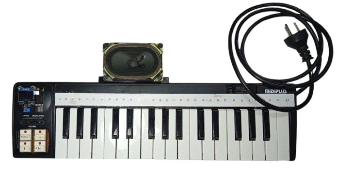

# Teclado musical para aprendizaje de música
 
Teclado sintetizador de bajo costo basado en ESP32, pensado para que niños aprendan música mediante un **modo aprendizaje** que guía la ejecución con LEDs.
 
Proyecto realizado en el marco de la asignatura **Proyecto Electrónico** de la Facultad de Ingeniería (FIO) – Universidad Nacional de Misiones (UNaM).
 

 
 
---
 
## Objetivos
 
Los objetivos planteados por la cátedra son:
 
- Diseñar y construir un teclado musical para el aprendizaje de música en niños, con tecnología transferible, de muy bajo costo y sin licencias de uso.
- Generar la documentación necesaria para su reproducción física.
- Emitir sonidos propios.
- Permitir cambiar parámetros musicales.
## Características
 
- 32 teclas con síntesis DDS por wavetables y salida I2S.
- Instrumentos activos: piano (Salamander Grand Piano) y guitarra.
- Modo aprendizaje: la tira LED WS2812B indica la nota a tocar y la canción avanza al ritmo del metrónomo, esperando a que se presione la nota correcta.
- Metrónomo configurable (3/4, 4/4, 5/4, 6/8, 7/8).
- Pantalla OLED con menú de configuración.
- Canciones permanentes en Flash y canciones adicionales en tarjeta SD (formato `.apr`).
## Estructura del repositorio
 
```
├── firmware/                       Código del ESP32 (ESP-IDF)
│   └── main/
│       ├── tasks/                  Tareas de FreeRTOS (audio, OLED, teclado, LEDs, SD, aprendizaje)
│       ├── notas/<instrumento>/    Wavetables y envolventes por instrumento (.h)
│       └── canciones/              Canciones permanentes en Flash (.h)
├── tools/
│   ├── wavetable_generator_octave/ Generación de wavetables y envolventes (Octave)
│   └── midi_processor_colab/       Conversión MIDI → .apr / .h (Python, Colab)
├── hardware/                       Proyecto KiCad: esquemáticos, PCB y lista de materiales
└── docs/                           manual de usuario e imágenes
```
 
## Flujo de trabajo
 
```
Grabaciones WAV/MP3 ──► Generador de wavetables (Octave) ──► .h de instrumentos ──┐
                                                                                  ├──► firmware (ESP-IDF) ──► ESP32
Archivos MIDI ────────► Procesador MIDI (Colab) ──► .h (Flash) ───────────────────┘
                                                └─► .apr ──► /APR en la tarjeta SD
```
 
## Requisitos
 
| Herramienta | Versión utilizada |
|---|---|
| ESP-IDF | v6.0.0 |
| GNU Octave | 11.1.0 (paquete `signal`) |
| Python | 3.x (Google Colab) con `mido` |
| KiCad | 9 |
 
## Uso rápido
 
### 1. Compilar y cargar el firmware
 
```bash
cd firmware
idf.py set-target esp32
idf.py build
idf.py -p PUERTO flash monitor
```
 
### 2. Generar wavetables de un instrumento
 
1. Colocar las grabaciones `.wav` del instrumento en `tools/wavetable_generator_octave/notas/<instrumento>/`.
2. Indicar el nombre del instrumento en `note_and_envelope_wavetable_generator.m` y ejecutarlo en Octave.
3. Copiar los `.h` generados en `notas/<instrumento>/salida_h/` a `firmware/main/notas/<instrumento>/`.
4. Agregar la carpeta en `INCLUDE_DIRS` de `firmware/main/CMakeLists.txt` y el instrumento en `firmware/main/tasks/Instrumentos.h`.
 
### 3. Convertir una canción MIDI
 
Abrir el notebook de [`tools/midi_processor_colab/`](tools/midi_processor_colab/) en Google Colab, cargar el `.mid` y elegir los canales a fusionar.
 
- Salida `.h` → `firmware/main/canciones/` (canción permanente en Flash).
- Salida `.apr` → carpeta `APR/` de la tarjeta SD.
### 4. Preparar la tarjeta SD
 
Formatear en FAT32, crear la carpeta `APR` en la raíz de la tarjeta y copiar ahí los `.apr` generados en el paso 3. El firmware busca las canciones en `/APR`.
 
## Hardware
 
| Bloque | Componentes principales |
|---|---|
| Control | ESP32 DevKit de 38 pines (CP2102) |
| Audio | DAC I2S PCM5102 + amplificador PAM8403 + altavoz de 4 Ω |
| Interfaz | Pantalla OLED I2C, tira LED WS2812B, expansor PCF8574 para pulsadores y LEDs |
| Teclado | Matriz de 32 teclas con diodos 1N4148 |
| Almacenamiento | Lector microSD |
| Alimentación | Fuente AC-DC Hi-Link HLK-10M05 (220 Vac → 5 V / 2 A) con fusible, regulador AMS1117-3.3 |
 
> **Precaución:** la placa trabaja con tensión de red de 220 Vac en la etapa de alimentación. Ensamblar y probar con las precauciones correspondientes, y montar el equipo en un gabinete cerrado antes de que lo usen niños.
 
El proyecto KiCad, el diagrama en bloques y la lista de materiales están en [`hardware/`](hardware/).
 
## Documentación
- Manual de usuario: [`docs/Manual_de_Usuario.pdf`](docs/Manual_de_Usuario.pdf).
## Créditos de muestras de audio
 
- **Salamander Grand Piano V3** – Alexander Holm ([sfzinstruments.github.io/pianos/salamander](https://sfzinstruments.github.io/pianos/salamander/)), licencia [CC BY 3.0](https://creativecommons.org/licenses/by/3.0/). Se usaron las muestras WAV de 16 bit a 44,1 kHz. Las wavetables y envolventes del firmware son obras derivadas: se extrajeron de esas grabaciones con el generador de Octave de este repositorio.
- **Philharmonia Sound Samples** – Philharmonia Orchestra ([philharmonia.co.uk/resources/sound-samples](https://philharmonia.co.uk/resources/sound-samples/)). Muestras de guitarra. Su licencia permite el uso libre, incluso comercial, siempre que las muestras no se vendan ni se distribuyan tal cual, ya sea como muestras o como instrumento de sampler.
> Por esta restricción, el repositorio **no incluye las grabaciones originales**. Solo incluye las wavetables y envolventes derivadas en formato `.h`. Para regenerarlas, descargá las muestras desde los sitios indicados y colocalas en `tools/wavetable_generator_octave/notas/<instrumento>/`.
 
## Créditos de canciones
 
### Canciones permanentes en Flash (`firmware/main/canciones/`)
 
| Canción | Origen de la melodía | Archivo |
|---|---|---|
| Estrellita | Melodía tradicional, dominio público | `cancion_estrellita.h` |
| Feliz cumpleaños | Melodía de *Good Morning to All*, M. J. y P. Hill, 1893, dominio público | `cancion_feliz_cumple.h` |
| Oda a la alegría | L. v. Beethoven, Sinfonía n.º 9, dominio público | `cancion_oda_alegria.h` |
| Para Elisa | L. v. Beethoven, WoO 59, dominio público | `cancion_para_elisa.h` |
 
## Bibliotecas de terceros
 
- **u8g2** – Oliver Kraus ([github.com/olikraus/u8g2](https://github.com/olikraus/u8g2)), licencia BSD de 2 cláusulas. Integrada mediante el componente ESP-IDF `nixy4/u8g2`.
- **led_strip** – Espressif Systems ([ESP Component Registry](https://components.espressif.com/components/espressif/led_strip)), licencia Apache 2.0.

## Autores

- Luis Carlos Hübner – [@LuisCarlos229](https://github.com/LuisCarlos229)
- Matias Emanuel Richart - [@MatiasRichart](https://github.com/MatiasRichart)

Cátedra de Proyecto Electrónico – FIO, UNaM.

## Licencias

Este proyecto se publica bajo licencias abiertas que permiten su uso, copia,
modificación, fabricación y comercialización sin pago de regalías:

| Contenido | Licencia | Archivo |
|---|---|---|
| Firmware ESP-IDF, scripts de Octave y Python | MIT | [LICENSE](LICENSE) |
| Hardware: esquemáticos, PCB, fabricación, BOM | CERN-OHL-P-2.0 | [hardware/LICENSE](hardware/LICENSE) |
| Documentación: manuales, guías, imágenes | CC BY 4.0 | [docs/LICENSE](docs/LICENSE) |
| Materiales de terceros: muestras de audio, librerías | Licencias propias | [NOTICE.md](NOTICE.md) |

Salvo que una carpeta tenga su propio archivo LICENSE, todo el contenido
original de este repositorio se publica bajo la licencia MIT.

## Aviso de responsabilidad

Este proyecto es un prototipo académico desarrollado en la Facultad de
Ingeniería de la Universidad Nacional de Misiones. Se entrega "tal cual",
sin garantía de ningún tipo. En la máxima medida permitida por la ley, los
autores no se responsabilizan por daños derivados de su fabricación, uso o
mal uso.

El dispositivo no está certificado como juguete según la normativa vigente.
Quien lo fabrique o distribuya es responsable de su seguridad y del
cumplimiento de las normas aplicables. Se recomienda su uso bajo
supervisión de un adulto.